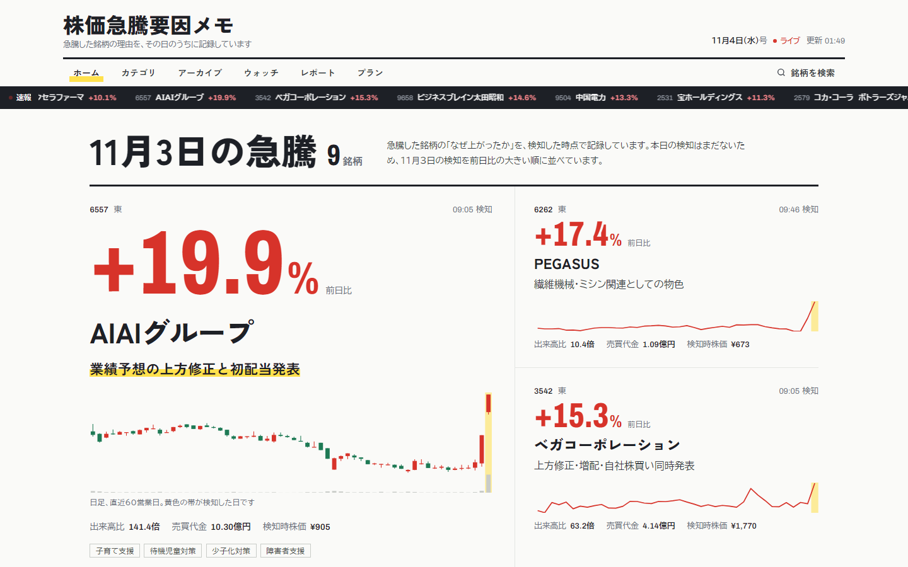
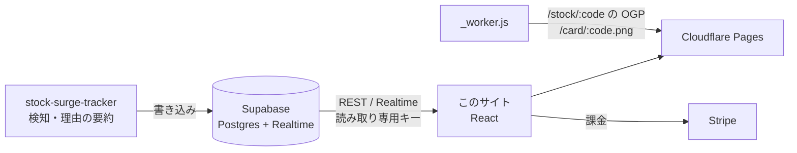

# 株価急騰要因メモ — サイト

急騰した日本株について「なぜ上がったのか」を、検知した時点で記録して公開しているサイトのソースです。

**運営中：[kyuutoumemo.com](https://kyuutoumemo.com)**



急騰の検知と理由の要約は、別リポジトリ [stock-surge-tracker](https://github.com/teletele-creater/stock-surge-tracker) のボットが行い、結果を Supabase に書き込みます。このサイトはそのデータを読んで表示します。

## できること

- **一面（トップ）**：その日の急騰銘柄を前日比の大きい順に並べ、大・中・小の記事として組む。各記事に日足チャートと検知日の印を描く
- **リアルタイム更新**：Supabase Realtime を購読し、新しい検知を再読み込みなしで差し込む
- **銘柄詳細**：急騰理由、事業内容、同じ銘柄の過去の検知履歴、ローソク足チャート（移動平均・パン操作つき）、連想銘柄、同じテーマの銘柄
- **アーカイブ**：日付・カレンダーでの切り替え、キーワード検索（全角半角・ひらがなカタカナを同一視し、「PCB」「プリント基板」などの言い換えにも対応）、急騰時からの変化率などの条件での絞り込み
- **集計**：初動後の伸びランキング（期間・指標を切り替え）、今週のテーマ勢力図（squarified treemap）、繰り返し検知される常連銘柄、急騰理由カテゴリ別の件数
- **ウォッチリストと押し目アラート**：登録銘柄の日足から、25日線・75日線付近への押し目を判定して知らせる
- **有料会員**：メールのワンタイムコードでログインし、Stripe で月額課金。週次レポートと過去データを会員限定にする
- **検索エンジン向けの銘柄ページ**：`/stock/{銘柄コード}` を Cloudflare の Worker で返すときに、その銘柄のタイトル・説明・構造化データ（JSON-LD）・本文を HTML に差し込む。JavaScript を実行しなくても中身が読め、`/sitemap.xml` も検知データから自動で作る。過去の検知メモは有料会員限定なので、HTML とサイトマップには最新の1件だけを載せる
- **X のカード**：同じ URL に来た X のクローラーには、チャート画像を使った OGP を返す

## 構成



| 項目 | 内容 |
|---|---|
| 画面 | React 18。ビルドを置かず、ブラウザ上の Babel で JSX を読み込む構成 |
| データ | Supabase（REST・Realtime・Auth） |
| チャート | Canvas と SVG を自前で描画。日足は Supabase の `stock_ohlc`、無ければ公開 API から取得し、ブラウザに15分キャッシュ |
| 配信 | Cloudflare Pages。`_worker.js` で OGP とカード画像だけを処理し、ほかは静的配信 |
| 決済 | Stripe Payment Links とカスタマーポータル |

## ファイル

| ファイル | 役割 |
|---|---|
| `index.html` | 色・書体などのデザイントークンと共通スタイル。各 JSX の読み込み |
| `app.jsx` | 画面の切り替え、URL ハッシュでの直リンク、PC とスマホのレイアウト |
| `ui.jsx` | 題字・ティッカー・一面の記事・一覧の行・小さなチャートなどの部品 |
| `pages.jsx` | 各ページ（ホーム、銘柄詳細、アーカイブ、カテゴリ、プランなど） |
| `live-data.jsx` | Supabase からの取得と Realtime の購読 |
| `real-chart.jsx` | ローソク足チャート |
| `dip-signal.jsx` | 押し目の判定とアラート |
| `weekly-report.jsx` | 会員向けの週次レポート |
| `auth.jsx` | ログインと会員判定、ペイウォール |
| `watchlist.jsx` | ウォッチリスト（ブラウザ内に保存） |
| `ads.jsx` / `ads-config.js` | PR 枠 |
| `_worker.js` | 銘柄ページの HTML 生成、サイトマップ、X のカード用 OGP とカード画像の配信 |

## 手元で動かす

ビルドは不要です。静的ファイルを配信できれば動きます。

```sh
python -m http.server 8080
# http://127.0.0.1:8080/ を開く
```

## 公開しているキーについて

`site-config.js` と `_worker.js` にある Supabase のキーは、ブラウザに配る前提の **anon（読み取り専用）キー** です。テーブルは行レベルセキュリティ（RLS）で保護し、このキーで読めるのは公開データだけにしています。書き込みに使う service_role キーはこのリポジトリには含めていません。


## 権利について

© 2026 teletele-creater. All rights reserved.

このリポジトリは、作品として読んでもらうために公開しています。オープンソースのライセンスは付けていないため、コードの全部または一部を、許可なく複製・改変・再配布したり、自分のサービスに使ったりすることはできません。利用したい場合はご連絡ください。
